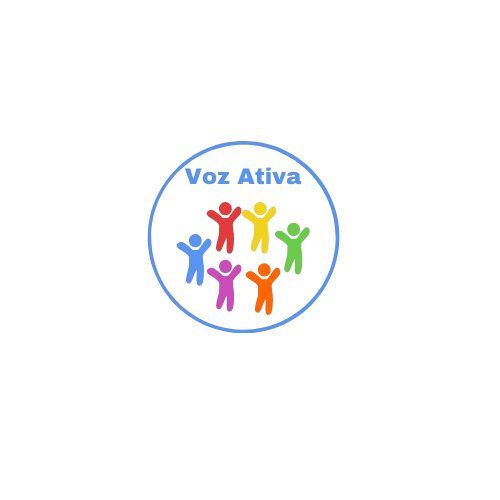

<div align="center">



# Voz Ativa

**Comunicação alternativa para crianças com TEA, com imagens e áudio ao alcance de um toque.**

<p>
  
  
  
  
</p>

<p>
  
  
</p>

</div>

---

## 📖 Sobre o projeto

O **Voz Ativa** é um aplicativo mobile de **Comunicação Aumentativa e Alternativa (CAA)** pensado para crianças com **Transtorno do Espectro Autista (TEA)** que têm dificuldade de se expressar verbalmente.

A criança navega por cartões com **imagens autodescritivas**. Ao tocar em um cartão, o app **reproduz em áudio** a frase correspondente, como *"Estou com fome"*, *"Quero um abraço"* ou *"Preciso de ajuda"*. Assim, ela consegue comunicar necessidades, sentimentos e desejos do dia a dia de forma simples e autônoma.

O projeto foi desenvolvido como **trabalho acadêmico** do curso de Tecnologia da Informação.

---

## ✨ Funcionalidades

- 🔐 **Cadastro e autenticação** de usuários com Clerk (e-mail e senha), com sessão salva de forma segura no dispositivo.
- 👦👧 **Escolha de perfil Menino ou Menina**, com ilustrações e vozes adaptadas para cada um e cores próprias (azul e lilás).
- 🗂️ **Cinco categorias do dia a dia**, com cerca de 45 frases no total:

  | Categoria | Exemplos de frases |
  | --- | --- |
  | 👋 **Saudações** | Bom dia, Boa noite, Oi mamãe, Obrigado, Sim, Não |
  | 🛁 **Rotina** | Quero tomar banho, Preciso lavar as mãos, Quero escovar os dentes |
  | 💛 **Emoções** | Estou feliz, Estou com medo, Quero um abraço, Te amo |
  | 🍎 **Comida** | Estou com fome, Estou com sede, Quero beber água, Quero repetir |
  | 👕 **Roupas** | Quero vestir uma camiseta, Quero usar short, Quero colocar meias |

- 🔊 **Áudio ao toque**: cada cartão reproduz a frase falada, para que a criança seja ouvida mesmo sem falar.
- 🎨 **Interface acessível**, com cartões grandes, cores vivas e pouca informação por tela, para facilitar o uso pelas crianças.

---

## 🛠️ Tecnologias

| Tecnologia | Uso no projeto |
| --- | --- |
| [React Native](https://reactnative.dev/) | Base do aplicativo mobile |
| [Expo (SDK 54)](https://expo.dev/) | Build, execução e acesso a recursos nativos |
| [Expo Router](https://docs.expo.dev/router/introduction/) | Navegação baseada em arquivos, com grupos de rotas públicas e autenticadas |
| [TypeScript](https://www.typescriptlang.org/) | Tipagem do código |
| [Clerk](https://clerk.com/) | Cadastro, login e gerenciamento de sessão |
| [expo-av](https://docs.expo.dev/versions/latest/sdk/av/) | Reprodução dos áudios das frases |
| [expo-secure-store](https://docs.expo.dev/versions/latest/sdk/securestore/) | Armazenamento seguro do token de sessão |
| [expo-image-picker](https://docs.expo.dev/versions/latest/sdk/imagepicker/) | Seleção de foto de perfil |

---

## 🗂️ Estrutura de pastas

```
src/
├── app/
│   ├── _layout.tsx          # ClerkProvider e redirecionamento conforme o login
│   ├── (public)/            # Rotas abertas: login e cadastro
│   └── (auth)/              # Rotas que exigem login
│       ├── genero/          # Escolha entre Menino e Menina
│       ├── homeboy/         # Categorias do perfil Menino
│       ├── homegirl/        # Categorias do perfil Menina
│       ├── menino/          # Telas de frases: saudacoes, rotina, emocoes, comida, roupa
│       └── menina/          # Telas de frases: saudacoes, rotina, emocoes, comida, roupa
├── components/
│   ├── header/              # Cabeçalho com botão de voltar
│   ├── categorias/          # Cartão de categoria da tela inicial
│   └── pressable/           # Cartão de frase que toca o áudio
├── constants/               # Cores e temas
├── db/                      # Dados das frases (db.ts = Menino, dbgirl.ts = Menina)
└── assets/
    ├── images/              # Ilustrações por perfil e categoria
    └── audio/               # Áudios por perfil e categoria
```

As frases ficam em arquivos locais (`src/db`), então o app funciona sem precisar de um banco de dados externo. Para adicionar uma frase nova, basta colocar a imagem e o áudio nas pastas da categoria e incluir um item no array correspondente:

```ts
{
  id: 10,
  descricao: 'Quero brincar',
  imagem: require('../assets/images/Menino/Rotina/quero_brincar_masculino.png'),
  audio: require('../assets/audio/Menino/Rotina/Menino_Brincar.mp3'),
  tema: 'boy',
}
```

---

## 🚀 Como executar

### Pré-requisitos

- [Node.js](https://nodejs.org/) 18 ou superior
- App **Expo Go** no celular ([Android](https://play.google.com/store/apps/details?id=host.exp.exponent) / [iOS](https://apps.apple.com/app/expo-go/id982107779)) ou um emulador
- Uma conta gratuita no [Clerk](https://clerk.com/) para gerar a chave de autenticação

### Passo a passo

```bash
# 1. Clone o repositório
git clone https://github.com/Dev-LuizPhillipe/Voz-Ativa.git
cd Voz-Ativa

# 2. Instale as dependências
npm install
npx expo install expo-router expo-av expo-secure-store expo-image-picker \
  expo-constants expo-linking expo-status-bar react-native-screens \
  react-native-safe-area-context @expo/vector-icons @clerk/clerk-expo
```

3. Crie um arquivo `.env` na raiz do projeto com a chave pública do Clerk:

```env
EXPO_PUBLIC_CLERK_PUBLISHABLE_KEY=pk_test_sua_chave_aqui
```

4. Inicie o projeto:

```bash
npx expo start
```

Depois, leia o QR Code com o Expo Go (Android) ou com a câmera (iOS), ou pressione `a` para abrir no emulador Android.

---

## 🧭 Próximos passos

- [ ] Concluir a tela de login (hoje o acesso é feito pelo cadastro)
- [ ] Permitir que pais e terapeutas criem frases personalizadas, com foto e gravação de voz
- [ ] Adicionar novas categorias, como escola, brincadeiras e lugares
- [ ] Opção de tamanho de cartão ajustável e modo de alto contraste
- [ ] Funcionamento offline completo, sem exigir login

---

## 👨‍💻 Autor

<table>
  <tr>
    <td align="center">
      <a href="https://github.com/Dev-LuizPhillipe">
        <br />
        <b>Luiz Phillipe</b>
      </a><br />
      <a href="https://www.linkedin.com/in/dev-luiz-phillipe/">LinkedIn</a>
    </td>
  </tr>
</table>

Projeto desenvolvido como trabalho acadêmico do curso de Tecnologia da Informação.

<div align="center">
  <sub>Feito com 💜 para que toda criança tenha voz.</sub>
</div>
